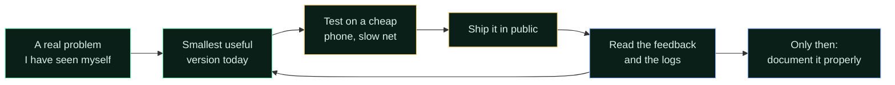
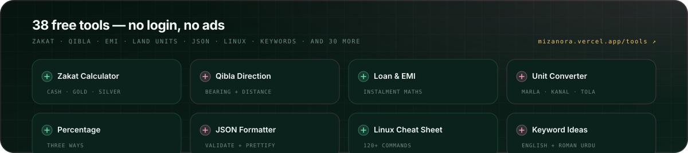

<div align="center">

<picture>
  <source media="(prefers-color-scheme: dark)" srcset="./assets/hero.svg" />
  <source media="(prefers-color-scheme: light)" srcset="./assets/hero-light.svg" />
  
</picture>

<sub>🕒 The clock in the banner is <b>live</b> — it follows Pakistan Standard Time (UTC+5) and keeps ticking in your browser.</sub>

<br /><br />

<a href="https://github.com/muaaziqbalvip"></a>


<br /><br />

<picture>
  <source media="(prefers-color-scheme: dark)" srcset="./assets/ticker.svg" />
  <source media="(prefers-color-scheme: light)" srcset="./assets/ticker-light.svg" />
  
</picture>

<br />

<a name="about" id="about"></a>
<a href="#about"><b>About</b></a> &nbsp;·&nbsp; <a href="#projects"><b>Projects</b></a> &nbsp;·&nbsp; <a href="#stack"><b>Stack</b></a> &nbsp;·&nbsp; <a href="#story"><b>Story</b></a> &nbsp;·&nbsp; <a href="#free-tools"><b>Free tools</b></a> &nbsp;·&nbsp; <a href="#contact"><b>Contact</b></a>

</div>

<br />

<table>
<tr>
<td width="61%" valign="top">

### Assalamu Alaikum, I'm Muaaz 👋

I'm a **17-year-old full-stack developer, AI builder and founder from Kasur, Punjab, Pakistan** — the kind of small city people call a limitation. I call it a starting point.

I build complete products alone: the database, the checkout, the Android app, the AI assistant, the docs and the deploy pipeline. Then I test them on a cheap phone over a slow connection, because that is the phone and the connection most of my users actually have.

My rule for every project: **if a shopper in Kasur can't use it in Urdu, it isn't finished.**

```text
currently   building Mizanora, Asaan Lang and BarakatWave TV
studying    ICS (computer science), Islamia Graduate College
writing     TypeScript, Python and Kotlin — and a lot of Roman-Urdu docs
believing   honest prices, halal earning, privacy by default
```

</td>
<td width="39%" valign="top">

**Quick facts**

| | |
|:--|:--|
| 📍 **Based in** | Kasur, Punjab, PK |
| 🕒 **Local time** | PKT · UTC+5 (live clock above) |
| 🎂 **Born** | 27 November 2009 |
| 🎓 **Studying** | ICS, Islamia Graduate College |
| 🚀 **Founded** | Mizanora · Muslim Islam Org |
| 🧠 **Focus** | Urdu-first products & AI |
| 💼 **Status** | Open to work & collabs |
| 🌐 **Site** | [mizanora.vercel.app](https://mizanora.vercel.app/muaaz-iqbal) |
| ✉️ **Email** | [muaaziqbal.vip@gmail.com](mailto:muaaziqbal.vip@gmail.com) |
| 💬 **WhatsApp** | [+92 306 2015326](https://wa.me/923062015326) |

</td>
</tr>
</table>

<div align="center">
<picture>
  <source media="(prefers-color-scheme: dark)" srcset="./assets/stats.svg" />
  <source media="(prefers-color-scheme: light)" srcset="./assets/stats-light.svg" />
  
</picture>
</div>

<br />

<div align="center">
<picture>
  <source media="(prefers-color-scheme: dark)" srcset="./assets/divider-work.svg" />
  <source media="(prefers-color-scheme: light)" srcset="./assets/divider-work-light.svg" />
  
</picture>
</div>

<a name="projects" id="projects"></a>

<div align="center">
<picture>
  <source media="(prefers-color-scheme: dark)" srcset="./assets/projects.svg" />
  <source media="(prefers-color-scheme: light)" srcset="./assets/projects-light.svg" />
  
</picture>
</div>

### The flagship work, in detail

<table>
<tr>
<td width="50%" valign="top">

#### 🛍️ Mizanora — *the shop*
**`Next.js 15` · `React` · `Tailwind` · `Firebase` · `PWA`**
[**Live store →**](https://mizanora.vercel.app)

A halal online market for Pakistan: **11,000+ products**, flat delivery, cash on delivery and an Urdu-speaking AI assistant called **Noor** that understands a messy sentence like *"sasta laal joota under 2k"*. Includes a worker/reseller programme with personal links and wallets, a promo-code engine, order tracking, a Quran + Hadith reader, live TV and 38 free tools. The catalogue is cached, so the shop keeps running even when a free quota runs out.

</td>
<td width="50%" valign="top">

#### 🧠 Asaan Lang — *the language*
**`Python 3.8+` · `MIT` · `Interpreter + site compiler`**
[**Repo →**](https://github.com/muaaziqbalvip/asaan-lang) · [**Site →**](https://asaan-lang.vercel.app)

Pakistan's own programming language. Beginners write `likho`, `agar / warna`, `har` and `kaam` in **Roman-Urdu or Urdu script** — no English wall first. Errors come back in Roman-Urdu with a line number, Urdu digits `۱۲۳` work, and `asaan --web` compiles a program into a real HTML site. Ships with a REPL, a browser playground and a full dictionary of keywords.

```asaan
naam = lo "Aap ka naam? "
agar naam != "" to
    likho "Khush Amdeed, " + naam + "!"
warna
    likho "Mehman, salaam!"
bas
```

</td>
</tr>
<tr>
<td width="50%" valign="top">

#### 📺 BarakatWave TV — *the network*
**`hls.js` · `FFmpeg` · `IMDb API` · `Vercel`**
[**Live →**](https://barakatwave.vercel.app)

A live TV and cinema platform for Pakistan and India: **800 channels**, multi-server relay failover, quality and audio-track switching, picture-in-picture, an IMDb-powered movie/series engine (`tt…` IDs → posters, cast, episodes) and Xtream Codes output that actually works in Televizo, TiviMate, XCIPTV and VLC. There's a four-part broadcast suite — welcome intro, offline card, discontinuity handoff — so no player chokes mid-stream.

</td>
<td width="50%" valign="top">

#### 🎬 SIRAVEX — *the player*
**`TypeScript` · `PWA` · `IndexedDB` · `HLS.js + Shaka`**
[**Live →**](https://siravex.vercel.app)

An installable, privacy-first media player for **your own authorised** playlists: M3U import (file or URL), Xtream Codes, XMLTV EPG, series grouping from `S01E02` titles, and an offline app shell. Nothing is bundled and nothing is uploaded — playlists, favourites, progress and settings stay in the browser, and diagnostics show hosts only, never tokens.

</td>
</tr>
<tr>
<td width="50%" valign="top">

#### 📈 MI Trade Master — *the app*
**`Kotlin` · `Jetpack Compose` · `Firebase` · `Groq`**
[**Repo →**](https://github.com/muaaziqbalvip/MITRADERS)

An Android platform to **learn** trading, read charts with AI and practise on paper — no real money, and nothing that pretends the market is a shortcut. Bilingual Urdu + English, Material 3, Firebase auth and a Groq-powered chart reader for beginners who would otherwise be sold a "guaranteed profit" course.

</td>
<td width="50%" valign="top">

#### 🤖 MI Trade Master Bot — *the 24/7 engine*
**`Python` · `Telegram API` · `GitHub Actions` · `Vision AI`**
[**Repo →**](https://github.com/muaaziqbalvip/MI-TRADE-MASTER-TELE-BOT)

A signal bot that runs free, 24/7, with **no server at all**: Smart Money Concepts structure (BOS / HH-HL / LH-LL) fused with RSI, EMA stack, MACD, Bollinger and Stochastic into one confidence score. Send it a screenshot from any platform and it marks the read on *your* image. Multi-key provider rotation, `/logs` diagnostics, per-user preferences.

</td>
</tr>
</table>

<details>
<summary><b>🔎 More of the work — AI agents, streaming infrastructure, Islamic tools (click)</b></summary>

<br />

<table>
<tr><th align="left">Project</th><th align="left">What it does</th><th align="left">Stack</th></tr>
<tr>
<td><a href="https://github.com/muaaziqbalvip/MIZANORA-AIWHATSAPP"><b>Mizanora WhatsApp AI</b></a></td>
<td>Multi-provider WhatsApp agent: persistent memory, Urdu voice notes with emotion, live search with citations, image generation, PDF reading and owner-only code execution. Survives GitHub Actions' 6-hour limit by encrypting state and re-dispatching itself.</td>
<td><code>Python</code> <code>Groq</code> <code>Gemini</code> <code>edge-tts</code></td>
</tr>
<tr>
<td><a href="https://github.com/muaaziqbalvip/MIZANORATVCAST"><b>StreamForge 24/7</b></a></td>
<td>Self-healing broadcast system: add a channel in a web dashboard and it generates its own GitHub Actions workflow, runs FFmpeg slots with a 5-minute overlap and hands off between runners so the stream never drops.</td>
<td><code>FFmpeg</code> <code>Actions</code> <code>Node.js</code></td>
</tr>
<tr>
<td><a href="https://github.com/muaaziqbalvip/Mizanoraandroid"><b>Mizanora Android</b></a></td>
<td>An always-on Android emulator living on GitHub Actions — emulator + ws-scrcpy + cloudflared, re-dispatched every 5h30, controlled from a Vercel panel and an APK.</td>
<td><code>Shell</code> <code>Actions</code> <code>Vercel</code></td>
</tr>
<tr>
<td><a href="https://mizanoraot.vercel.app"><b>Mizanora Order Tracking</b></a></td>
<td>Local and international tracking IDs with an animated parcel journey, stage timeline, share sheet and PWA install. Honest about what data is estimated and what comes from the courier.</td>
<td><code>Serverless</code> <code>PWA</code> <code>SEO</code></td>
</tr>
<tr>
<td><a href="https://github.com/muaaziqbalvip/minexustv2026"><b>Minexus TV</b></a></td>
<td>Vercel-ready streaming front end with TMDB-powered releases, calendar, auto-built news cards and a guest mode that needs no login.</td>
<td><code>JavaScript</code> <code>TMDB</code></td>
</tr>
<tr>
<td><a href="https://github.com/muaaziqbalvip/Mitvplayer"><b>MiTV Player</b></a></td>
<td>Android IPTV player with four themes, gesture brightness and volume, HLS · DASH · MKV playback via Media3, and auto-retry when a stream dies.</td>
<td><code>Kotlin</code> <code>Compose</code> <code>ExoPlayer</code></td>
</tr>
<tr>
<td><a href="https://muslimislam.vercel.app"><b>Muslim Islam Org</b></a></td>
<td>Community portal: team directory, project hub, chat relay, device and network tools — built for a real organisation, not a demo.</td>
<td><code>React</code> <code>Firebase</code></td>
</tr>
<tr>
<td><a href="https://github.com/muaaziqbalvip/Mitv-RMADAN-clender"><b>Ramadan Calendar</b></a></td>
<td>Sehr and Iftar countdowns by location, daily duas and one-tap sharing for Pakistani families.</td>
<td><code>HTML</code> <code>JS</code></td>
</tr>
</table>

<details>
<summary><b>🗂️ The rest of the lab — every other build, grouped (click)</b></summary>

<br />

| Shelf | Repositories |
|:--|:--|
| **Real-time streaming** | [MIZANORATVCAST](https://github.com/muaaziqbalvip/MIZANORATVCAST) · [MIZANORATV](https://github.com/muaaziqbalvip/MIZANORATV) · [minexustv2026](https://github.com/muaaziqbalvip/minexustv2026) · [MINEXUSTV](https://github.com/muaaziqbalvip/MINEXUSTV) · [Mitvwebsite](https://github.com/muaaziqbalvip/Mitvwebsite) · [Mitv-player-web](https://github.com/muaaziqbalvip/Mitv-player-web) · [MITVPRO2026](https://github.com/muaaziqbalvip/MITVPRO2026) · [24-7](https://github.com/muaaziqbalvip/24-7) · [Mi-live-chanells](https://github.com/muaaziqbalvip/Mi-live-chanells) · [Stream3](https://github.com/muaaziqbalvip/Stream3) · [Mytvmitv](https://github.com/muaaziqbalvip/Mytvmitv) · [PTV](https://github.com/muaaziqbalvip/PTV) |
| **AI agents & automation** | [MIZANORA-AIWHATSAPP](https://github.com/muaaziqbalvip/MIZANORA-AIWHATSAPP) · [MICH-AI-LIVE](https://github.com/muaaziqbalvip/MICH-AI-LIVE) *(AI software factory on Actions)* · [Mizanora-agent-web](https://github.com/muaaziqbalvip/Mizanora-agent-web) · [MIAI](https://github.com/muaaziqbalvip/MIAI) · [MIAIWORLD](https://github.com/muaaziqbalvip/MIAIWORLD) · [MIAIOFLINE](https://github.com/muaaziqbalvip/MIAIOFLINE) · [MICHATBOT-AI](https://github.com/muaaziqbalvip/MICHATBOT-AI) · [MIBOOTPROGRAM](https://github.com/muaaziqbalvip/MIBOOTPROGRAM) |
| **Trading tools** | [MITRADERS](https://github.com/muaaziqbalvip/MITRADERS) · [MI-TRADE-MASTER-TELE-BOT](https://github.com/muaaziqbalvip/MI-TRADE-MASTER-TELE-BOT) · [MITRADEPANEL](https://github.com/muaaziqbalvip/MITRADEPANEL) · [Mitradegraphs](https://github.com/muaaziqbalvip/Mitradegraphs) · [MITRADERAPP](https://github.com/muaaziqbalvip/MITRADERAPP) · [MIRpro](https://github.com/muaaziqbalvip/MIRpro) · [misignalbot](https://github.com/muaaziqbalvip/misignalbot) · [miaitrade](https://github.com/muaaziqbalvip/miaitrade) · [MIESPORTS](https://github.com/muaaziqbalvip/MIESPORTS) |
| **Shops & commerce** | [MIZANORA](https://github.com/muaaziqbalvip/MIZANORA) · [MIZANORAOT](https://github.com/muaaziqbalvip/MIZANORAOT) · [MIRESALER](https://github.com/muaaziqbalvip/MIRESALER) · [MICHSHOP](https://github.com/muaaziqbalvip/MICHSHOP) · [MICHSHOPFIX](https://github.com/muaaziqbalvip/MICHSHOPFIX) · [MICHDIGITALSHOP](https://github.com/muaaziqbalvip/MICHDIGITALSHOP) · [Michytadmin](https://github.com/muaaziqbalvip/Michytadmin) · [Mistore](https://github.com/muaaziqbalvip/Mistore) · [Mi_Earn](https://github.com/muaaziqbalvip/Mi_Earn) |
| **Islamic & community** | [Mitv-RMADAN-clender](https://github.com/muaaziqbalvip/Mitv-RMADAN-clender) · [Muslimislamtv](https://github.com/muaaziqbalvip/Muslimislamtv) · [Zimmal](https://github.com/muaaziqbalvip/Zimmal) · [ILMFEEDS](https://github.com/muaaziqbalvip/ILMFEEDS) · [MI-VOTING](https://github.com/muaaziqbalvip/MI-VOTING) · [UKACCOUNTS](https://github.com/muaaziqbalvip/UKACCOUNTS) |
| **Reading & learning** | [MI-BOOKS](https://github.com/muaaziqbalvip/MI-BOOKS) · [MI-LIBRARY](https://github.com/muaaziqbalvip/MI-LIBRARY) · [Midairy](https://github.com/muaaziqbalvip/Midairy) · [Mi-brain-hack](https://github.com/muaaziqbalvip/Mi-brain-hack) · [Bilawalblogs](https://github.com/muaaziqbalvip/Bilawalblogs) · [mi-ai-blog](https://github.com/muaaziqbalvip/mi-ai-blog) |
| **Devices & utilities** | [Mizanoraandroid](https://github.com/muaaziqbalvip/Mizanoraandroid) · [MIZANORAaiapp](https://github.com/muaaziqbalvip/MIZANORAaiapp) · [Mitvplayer](https://github.com/muaaziqbalvip/Mitvplayer) · [MIAPPBUILDER](https://github.com/muaaziqbalvip/MIAPPBUILDER) · [M3u8-mask](https://github.com/muaaziqbalvip/M3u8-mask) · [Streamset](https://github.com/muaaziqbalvip/Streamset) · [Watch](https://github.com/muaaziqbalvip/Watch) · [Michatting](https://github.com/muaaziqbalvip/Michatting) |

<sub>These are experiments, tools and client work in different states of finish — most are private-scale, a few are deliberately half-built. Forks and archived repos are not listed, and each repo's own README says honestly what works and what doesn't.</sub>

</details>

<br />

> Every project above has its own README with setup, secrets and honest limitations. Nothing here is a landing page for a product that doesn't exist.

</details>

<br />

<div align="center">
<picture>
  <source media="(prefers-color-scheme: dark)" srcset="./assets/divider-stack.svg" />
  <source media="(prefers-color-scheme: light)" srcset="./assets/divider-stack-light.svg" />
  
</picture>
</div>

<a name="stack" id="stack"></a>

<div align="center">
<picture>
  <source media="(prefers-color-scheme: dark)" srcset="./assets/tech-stack.svg" />
  <source media="(prefers-color-scheme: light)" srcset="./assets/tech-stack-light.svg" />
  
</picture>
</div>

<div align="center">
<picture>
  <source media="(prefers-color-scheme: dark)" srcset="./assets/languages.svg" />
  <source media="(prefers-color-scheme: light)" srcset="./assets/languages-light.svg" />
  
</picture>
</div>

| Area | How I work in it |
|:--|:--|
| **Web engineering** | Next.js App Router, React, Tailwind — phone-first, keyboard accessible, SEO with real structured data |
| **Android** | Kotlin + Jetpack Compose + Media3, shipped through a repeatable APK pipeline |
| **AI orchestration** | Groq, Gemini, Claude, Qwen and OpenAI together: one model plans, another writes, I test and decide. Multi-key rotation and graceful fallback so one dead API never kills a product |
| **Voice & language** | Whisper STT, edge-tts Urdu, Roman-Urdu → Urdu script translation, RTL layouts |
| **Streaming** | FFmpeg pipelines, HLS/DASH, m3u8 relays, 24/7 handoff between short-lived GitHub runners |
| **Data** | Firestore with quota-aware caching, M3U / XMLTV / XLSX / CSV import pipelines, catalogue scrapers |
| **Design** | Brand identity, logo, UI wireframes, video edits — I do my own visuals |

<br />

<div align="center">
<picture>
  <source media="(prefers-color-scheme: dark)" srcset="./assets/divider-story.svg" />
  <source media="(prefers-color-scheme: light)" srcset="./assets/divider-story-light.svg" />
  
</picture>
</div>

<a name="story" id="story"></a>

<div align="center">
<picture>
  <source media="(prefers-color-scheme: dark)" srcset="./assets/journey.svg" />
  <source media="(prefers-color-scheme: light)" srcset="./assets/journey-light.svg" />
  
</picture>
</div>



1. **Think in years, act in days.** A big goal is only real if it has a version I can finish today.
2. **Build for my own people first.** Pakistani shoppers, Urdu-medium students, cheap Androids. If it works there, it works anywhere.
3. **Teach the machine, keep the judgement.** AI drafts the code, data and copy. I read it, test it and take responsibility for it.
4. **Be honest in public.** No fake countdowns, no invented discounts, no bought reviews, no "guaranteed profit". Projects that are experiments say so.
5. **Privacy is a feature.** IndexedDB over uploads, host-only diagnostics, no tracking pixels in products that don't need them.

<br />

<div align="center">
<picture>
  <source media="(prefers-color-scheme: dark)" srcset="./assets/philosophy.svg" />
  <source media="(prefers-color-scheme: light)" srcset="./assets/philosophy-light.svg" />
  
</picture>
</div>

<br />

<div align="center">
<picture>
  <source media="(prefers-color-scheme: dark)" srcset="./assets/divider-free.svg" />
  <source media="(prefers-color-scheme: light)" srcset="./assets/divider-free-light.svg" />
  
</picture>
</div>

<a name="free-tools" id="free-tools"></a>

<div align="center">
<picture>
  <source media="(prefers-color-scheme: dark)" srcset="./assets/free-tools.svg" />
  <source media="(prefers-color-scheme: light)" srcset="./assets/free-tools-light.svg" />
  
</picture>
</div>

Not everything useful has to be a startup. A few things I keep free and login-free for anyone in Pakistan:

- 🕌 **[Zakat calculator](https://mizanora.vercel.app/tools/zakat-calculator)** in PKR — cash, gold, silver and business goods
- 🧭 **[Qibla direction](https://mizanora.vercel.app/tools/qibla-direction)** with the distance to the Kaaba
- 📐 **[Unit converter](https://mizanora.vercel.app/tools/unit-converter)** for marla, kanal, tola and masha — the units we actually use
- 🧾 **[Loan and EMI calculator](https://mizanora.vercel.app/tools/loan-emi-calculator)** with total interest laid bare
- 📖 **[Quran](https://mizanora.vercel.app/quran)** and **[Hadith reader](https://mizanora.vercel.app/hadith)** — reading and Urdu translation
- 🧑‍💻 **[Linux cheat sheet](https://mizanora.vercel.app/tools/linux-commands-cheat-sheet)** with 120+ searchable commands

<br />

<div align="center">
<picture>
  <source media="(prefers-color-scheme: dark)" srcset="./assets/divider-contact.svg" />
  <source media="(prefers-color-scheme: light)" srcset="./assets/divider-contact-light.svg" />
  
</picture>
</div>

<a name="contact" id="contact"></a>

## 🤝 Let's build something

I'm open to **freelance work, collaborations and internships** — especially anything that brings software to people in their own language: Urdu-first products, education tools, Android apps, AI agents and streaming infrastructure.

<table>
<tr>
<td align="center" width="25%">

**📧 Email**<br />
[muaaziqbal.vip@gmail.com](mailto:muaaziqbal.vip@gmail.com)

</td>
<td align="center" width="25%">

**💬 WhatsApp**<br />
[+92 306 2015326](https://wa.me/923062015326)

</td>
<td align="center" width="25%">

**💼 LinkedIn**<br />
[Muaaz Iqbal](https://pk.linkedin.com/in/muaaz-iqbal-744b25430)

</td>
<td align="center" width="25%">

**🌐 Website**<br />
[mizanora.vercel.app](https://mizanora.vercel.app/muaaz-iqbal)

</td>
</tr>
</table>

<details>
<summary><b>📫 Everywhere else (click)</b></summary>

<br />

| Platform | Where |
|:--|:--|
| **GitHub** | [@muaaziqbalvip](https://github.com/muaaziqbalvip) |
| **YouTube** | [@MuaazIqbalofficial](https://www.youtube.com/@MuaazIqbalofficial) |
| **X** | [@MizanoraApps](https://x.com/MizanoraApps) |
| **Instagram** | [@mizanora](https://www.instagram.com/mizanora) |
| **Asaan Lang** | [asaan-lang.vercel.app](https://asaan-lang.vercel.app) |
| **BarakatWave TV** | [barakatwave.vercel.app](https://barakatwave.vercel.app) |
| **SIRAVEX** | [siravex.vercel.app](https://siravex.vercel.app) |
| **Mizanora Projects** | [mizanora.vercel.app/muaaz-iqbal](https://mizanora.vercel.app/muaaz-iqbal) |

</details>

<br />

<div align="center">

### 💚 If something here helped you, a ⭐ on the repo is the whole payment.

<br />

<p>
  <b>Muaaz Iqbal</b> · Kasur, Punjab, Pakistan 🇵🇰<br />
  <sub>“Unchi soch. Chhote qadam.” — high thinking, small steps.</sub>
</p>

<picture>
  <source media="(prefers-color-scheme: dark)" srcset="./assets/ticker.svg" />
  <source media="(prefers-color-scheme: light)" srcset="./assets/ticker-light.svg" />
  
</picture>

<sub>Last refreshed · 30 October 2026 · built by hand, tested on a cheap phone</sub>

</div>
